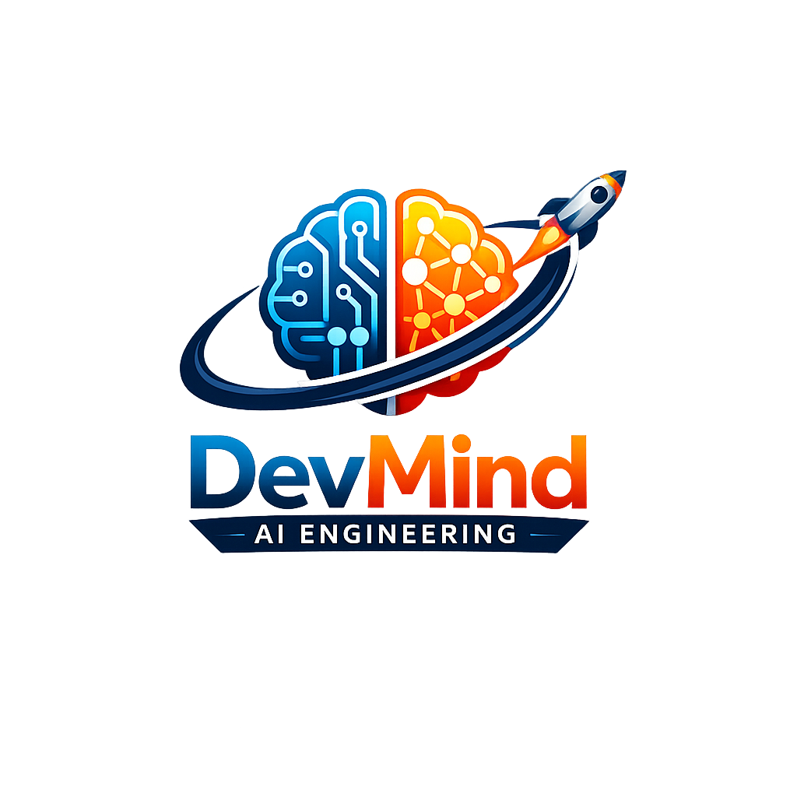
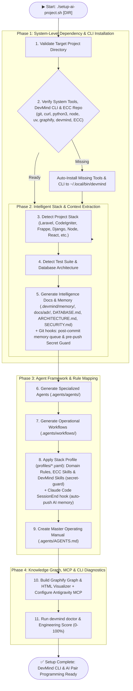
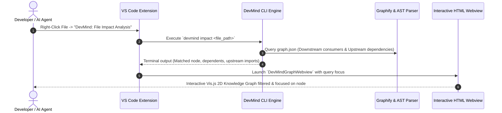
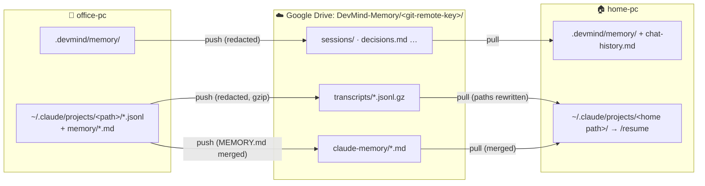

<p align="center">
  
</p>

# 🚀 DevMind Enterprise AI Operating System & CLI Suite (v3.0.0)

An intelligent, developer-friendly **AI Engineering Operating System & Unified CLI Tool (`devmind`)**. It unifies **Everything Claude Code (ECC)**, **Graphify Knowledge Graphs**, **Specialized Agent Personas**, **Operational Workflows**, **Git & Database Intelligence**, **Project Memory Layer**, **ADR Management**, **Secret Guard**, **AI Memory Sync via Google Drive**, and **Antigravity IDE MCP Integration** into a single cohesive operating framework.

> **Core principle:** **Git = code only. Google Drive = AI memory only.** Secrets go nowhere.

---

## 🆕 What's New

| Feature | Summary |
| :--- | :--- |
| 🛡️ **Secret Guard** | `devmind scan` + a git **pre-push hook** block pushes that contain API keys, passwords, tokens, private keys, `.env` files, DB dumps, or AI chat history. Works for humans *and* AI agents. |
| ☁️ **AI Memory Sync (Google Drive)** | `devmind memory push/pull` syncs chat history, session summaries, Claude auto-memory, and resumable Claude transcripts between machines (e.g. office PC ⇄ home PC). |
| 🔌 **One-click "Connect Google Drive"** | The VS Code extension installs `rclone` (no sudo, SHA256-verified), opens the Google login, and verifies access. It uses the `drive.file` scope only. |
| 🧩 **Auto-installed AI skills** | The VSIX bundles the `secret-guard` skill and writes it into every project's `.agents/skills/` and `.claude/skills/` on activation. |
| 🧱 **Stack profiles** | `profiles/*.yaml` (Frappe, Laravel, Django, FastAPI, Next.js, React, Node, Generic) choose which ECC skills, agents, and rules each project gets. Nested Frappe apps are auto-detected. |
| 🌌 **Antigravity IDE support** | `rebuild-and-install.sh` now also installs the VSIX into Antigravity IDE. |

---

## 📊 Graphical System Architecture & Workflow

### 1. Master System Pipeline (11-Step Integration)



---

### 2. VS Code Extension & File Impact Workflow



---

### 3. System Flow & Memory Loop

```text
                     DevMind
                        │
       ┌────────────────┼────────────────┐
       │                │                │
       ▼                ▼                ▼
   Graphify          Git Intel        ADR System
       │                │                │
       │                │         ┌──────┴──────┐
       │                │         │             │
       │                │       API AI       Agent AI
       │                │         │             │
       │                │         └──────┬──────┘
       │                │                │
       └────────────────┼────────────────┘
                        ▼
                  Project Memory
                        │
                        ▼
                  AI Coding Agent
```

---

## 🎨 VS Code Extension Graphical Interface

The native **DevMind VS Code Extension** (`devmind-vscode`) integrates AI intelligence directly into your IDE layout:

```
+------------------------------------+--------------------------------------------------+
| VS CODE ACTIVITY BAR               | EDITOR & INTERACTIVE GRAPH WEBVIEW               |
+------------------------------------+--------------------------------------------------+
| [DevMind OS Sidebar]               |  [graphify-out/graph.html]                       |
|                                    |  +--------------------------------------------+  |
|  🩺 System Health & Score          |  | 🧠 DevMind Knowledge Graph v2.0  [Search]   |  |
|     ├── Engineering Score: 89%     |  |                                            |  |
|     ├── Run Doctor Diagnostics     |  |   (Node A) ---> [Target File] ---> (Node B) |  |
|     └── Sync AI Context            |  |                     |                      |  |
|                                    |  |                     v                      |  |
|  🧠 Project Memory                 |  |                 (Node C)                   |  |
|     ├── 🔌 Connect Google Drive    |  +--------------------------------------------+  |
|     ├── ⬆ Push / ⬇ Pull Memory     |                                                  |
|     ├── 🔄 Sync All Projects       |                                                  |
|     ├── 🕘 Chat History            |                                                  |
|     ├── decisions.md               |                                                  |
|     └── project-history.md         |  OUTPUT CHANNEL: [DevMind OS]                    |
|                                    |  ============================================    |
|  📜 Architecture Decisions (ADRs)  |  Target Symbol/File: setup-ai-project.sh         |
|     ├── + Create New ADR           |  Matched Node: setup-ai-project.sh               |
|     └── 001-initial-arch.md        |  Direct Consumers:                               |
|                                    |    └── setup_ai_project_build_graphify_graph    |
|  📊 Knowledge Graph & Impact       |  ============================================    |
|     ├── Graphify Index: Active     |                                                  |
|     ├── Open Interactive Graph     |                                                  |
|     └── Analyze File Impact...     |                                                  |
+------------------------------------+--------------------------------------------------+
| STATUS BAR: $(brain) DevMind: 89%   ☁️ Synced 5 min ago (click: Push/Pull/Sync menu)  |
+---------------------------------------------------------------------------------------+
```

**Extension features at a glance:**
- **Status bar:** `$(brain)` shows the Engineering Score. ☁️ shows memory sync state: yellow means *Connect Google Drive*, red means the last sync failed.
- **Auto memory sync:** pulls when a project opens, pushes every 30 minutes, and pushes when the window closes. Configure it with these settings:
  - `devmind.memory.autoPullOnStartup`
  - `devmind.memory.autoPushMinutes`
  - `devmind.memory.pushOnClose`
- **Auto skill install:** writes `secret-guard` into `.agents/skills/` and `.claude/skills/` of every open folder.
  - Files with `origin: DevMind` and an older `version:` are updated.
  - Customised copies (`origin: custom`) are never touched.
  - Manual command: `DevMind: Install AI Skills`.
- **Smart CLI selection:** if a project's `bin/devmind` copy is too old for a feature, the extension falls back to `~/.local/bin/devmind`.

---

## 💻 `devmind` CLI Suite Command Reference

The `devmind` CLI tool provides full control over AI context, task planning, dependency impact, security auditing, and project memory:

| Command | Description |
| :--- | :--- |
| `devmind doctor` | Runs 8-dimensional diagnostic suite & calculates Engineering Score (0–100%). |
| `devmind status` | Checks staleness of local files, the Graphify graph, and the context manifest. |
| `devmind sync` | Automatically updates Graphify graph, HTML visualizer, and intelligence docs, then processes the queue. |
| `devmind queue "<task>"` | Queues a commit/task event (used by the post-commit hook) for the next sync. |
| `devmind plan "<task>"` | AI Task Planner: affected modules, risk level, required database tables & tests. |
| `devmind debug "<issue>"` | AI Debugger combining Git Blame, Git Bisect, and the Knowledge Graph. |
| `devmind why <file>` | File Intelligence: purpose, ownership, graph edges, and history. |
| `devmind regression [good] [bad]` | Automated Git Bisect regression suite. |
| `devmind impact <file>` | Impact Analysis: dependency resolution & downstream/upstream consumers. |
| `devmind blame <file>` | Git Intelligence: commit history, author changes, and change rationale. |
| `devmind audit security` | Security Scanner: secret detection, SQLi, XSS, OWASP checks, and security score. |
| `devmind scan [--staged\|--pre-push\|--range A..B\|--all]` | 🛡️ **Secret Guard**: finds secrets & sensitive files. Exit code `1` blocks the commit/push. |
| `devmind memory connect` | ☁️ One-step Google Drive connection (installs rclone, browser login, verifies). |
| `devmind memory push` / `pull` / `sync` | Upload / download / both: AI memory, chat history, Claude memory & transcripts. |
| `devmind memory sync-all` | Pull + push every project registered on this machine. |
| `devmind memory status [--json]` | Shows remote, machine name, session count, and last push/pull/error. |
| `devmind memory capture` / `index` | Turns Claude sessions into redacted summaries / rebuilds `chat-history.md`. |
| `devmind memory setup --remote <r> --machine <name>` | Uses a custom rclone remote or a plain folder instead of the default Drive remote. |
| `devmind memory disconnect` | Removes the Drive connection on this machine (Drive files are kept). |
| `devmind db analyze` | Database Intelligence v2: table relationships, foreign keys, missing indexes. |
| `devmind review` | AI Code Review Bot inspecting uncommitted `git diff`. |
| `devmind adr create "<title>"` | Creates a new Architecture Decision Record in `docs/adr/`. |
| `devmind adr list` | Lists existing Architecture Decision Records. |
| `devmind infra audit` | Audits production infrastructure (Nginx, PHP-FPM, Docker, Redis, MariaDB). |

---

## 🧠 Project Memory Layer (`.devmind/memory/`) & ADRs

DevMind maintains a long-term engineering memory so AI agents never repeat past mistakes:
- **`decisions.md`**: Architectural & technical design choices.
- **`known-issues.md`**: Active technical debt & known bugs.
- **`failed-attempts.md`**: Past technical approaches that failed and rationale.
- **`project-history.md`**: System evolution log.
- **`chat-history.md`**: Auto-generated index of previous AI sessions from **all machines**, newest first. AI agents read this before starting work. It is rebuilt locally and never synced or committed.
- **`sessions/YYYY-MM-DD_<machine>_<id>.md`**: One redacted summary per Claude Code session: requests, files changed, commands, final outcome, and the full conversation.
- **`docs/adr/`**: Sequential Architecture Decision Records (e.g., `001-initial-architecture.md`).

> `.devmind/` is gitignored in projects. Memory travels between machines through Google Drive, never through git.

### 🛠️ Directory Scoping & Manual Override
You can manually scope DevMind CLI actions (like sync, diagnostics, and knowledge graphs) to specific nested sub-repositories or folders (e.g., `app/mycustom_app` in Frappe/monorepos). Set this via the **Target Repo** setting in the VS Code extension sidebar or using the `devmind.selectDirectory` command.

### 🤖 AI-Driven Automated ADR Generation
When creating an ADR (`devmind adr create "<title>"`), DevMind automatically drafts its contents (Context, Decision, and Consequences) using a dual-automation strategy:
1. **Direct API Integration:** If environment keys (`GEMINI_API_KEY`, `OPENAI_API_KEY`, `DEEPSEEK_API_KEY`, or `ANTHROPIC_API_KEY`/`CLAUDE_API_KEY`) are present, the CLI queries the LLM directly via a lightweight request, feeding it the relevant `git diff` or commit context.
2. **Coding Agent Auto-Population:** If no keys are set but you are working inside an AI coding agent (like Antigravity, Claude Code, or Cursor), the CLI writes a `<!-- DEVMIND_PENDING_ADR_AI_POPULATION -->` marker and prints a visible terminal directive. The active agent intercepts this and automatically populates the ADR contents based on the git changes.

---

## ☁️ AI Memory Sync (Google Drive)

Work at the office, continue at home, and your AI keeps its context. DevMind syncs **memory only** to Google Drive. Code stays in git.



### What gets synced

| Data | Format | Local location | On Drive | Purpose |
| :--- | :--- | :--- | :--- | :--- |
| DevMind memory & session summaries | Markdown | `.devmind/memory/` | `<project>/` | Context for any AI agent |
| Claude Code transcripts | JSONL (gzip) | `~/.claude/projects/<path>/<id>.jsonl` | `<project>/transcripts/` | Continue a session at home with `/resume` |
| Claude Code auto-memory | Markdown | `~/.claude/projects/<path>/memory/` | `<project>/claude-memory/` | Facts Claude remembers about you/the project |
| Claude login & config | JSON | `~/.claude.json`, `.credentials.json` | ❌ **never** | Contains your login token |

### How it stays safe and conflict-free
- **Project identity from the git remote URL.** `/var/www/html/sundora` and `~/projects/sundora` map to the same Drive folder (`github.com_invento-pos_sundora`).
- **No overwrites between machines.**
  - Each machine names its session files after itself (`2026-11-05_office-pc_dc9b703e.md`).
  - `rclone copy --update` never deletes anything.
  - `MEMORY.md` is merged line by line.
  - Locally changed transcripts are kept and reported as "kept local".
- **Paths rewritten.** Transcripts pulled on another machine get the local checkout path, so `/resume` works.
- **Redaction before upload.**
  - API keys, tokens, passwords, DB URLs and e-mail addresses become `[REDACTED:<rule>]`.
  - Raw API payloads are dropped.
  - The push is **blocked** if any memory file still contains a secret.
- **Least privilege.** The Google token uses the `drive.file` scope, so DevMind can only see files it created itself.
- **Nothing in the repo.** Transcripts are staged in `~/.cache/devmind/transcripts/`, never in the project directory.

### Connect Google Drive (once per machine)
1. In VS Code/Antigravity, click **☁️ Connect Google Drive**. It's in the status bar and in the sidebar under 🧠 Project Memory.
2. Enter a machine name (`office-pc`, `home-pc`, …).
3. Sign in to Google in the browser and click **Allow**.

CLI equivalent: `devmind memory connect --machine office-pc`.

What happens behind the scenes:
1. `rclone` is installed to `~/.local/bin` if missing. The official release is SHA256-verified and no sudo is needed.
2. `rclone authorize drive` runs the OAuth flow.
3. The token is saved as the dedicated remote `[devmind-gdrive]` in `~/.config/rclone/rclone.conf` (mode `600`).
4. `DevMind-Memory/` is created and verified.
5. The config is stored in `~/.config/devmind/memory.json`.

Automatic sync after connecting:
- **VS Code:** pull on open, push every 30 min, push on close.
- **Claude Code:** a `SessionEnd` hook in `.claude/settings.local.json` pushes when a session ends.

> ⚠️ **Known limitation:** rclone's shared Google client ID is being retired during 2026. Plan to switch to your own Google Cloud OAuth client ID to keep sync working.

---

## 🛡️ Secret Guard

A git **pre-push hook** runs `devmind scan --pre-push` on every push and blocks it when the commits being pushed contain sensitive data. It applies to developers and AI agents alike. The bundled **`secret-guard` skill** tells AI agents to scan before pushing, fix findings properly, and never bypass the hook.

| Detects | Examples |
| :--- | :--- |
| Tokens & keys | AWS, GitHub, Anthropic, OpenAI, Stripe live, Braintree production, Slack, Google API/OAuth, Shopify, JWT, private key blocks |
| Credentials | Hard-coded `password`/`secret`/`api_key`/`token` assignments (incl. CodeIgniter `$db['default']['password']`), DB URLs with passwords |
| Sensitive files | `.env*` (except `.example/.sample/.template/.dist`), `*.pem/*.key/*.p12/*.pfx`, SSH keys, `credentials.json`, service-account JSON, `.htpasswd`, DB dumps (> 1 MB `.sql`, `.dump`, `.bak`) |
| AI memory | `.devmind/memory/sessions/`, `chat-history.md`, raw Claude transcripts |

**Low noise by default.** Placeholders, `env()`/`getenv()` calls, Laravel validation rules, translation files and vendored test fixtures are ignored. High-confidence token patterns still apply everywhere. Findings are shown masked (`sk_l***`).

**False positives:**
- Add a `devmind:allow-secret` comment on the line, or
- Add a path glob or `regex:<pattern>` line to `.secretscanignore` at the repo root.

**Manual checks:**
- `devmind scan --staged`: before a commit.
- `devmind scan --range @{u}..HEAD`: before a push.
- `devmind scan --all`: audit every tracked file.

**One-time bypass** (humans only, after checking the findings): `DEVMIND_SKIP_SECRET_SCAN=1 git push`.

> If a real key was ever pushed, **rotate it** at the provider. Removing it from git history does not undo the exposure.

---

## 🧱 Stack Profiles (`profiles/*.yaml`)

The setup script detects the stack and applies a profile that lists which **ECC skills, agents, and rules** to link into `.agents/` and `.claude/`. Available profiles:
- `frappe`
- `laravel`
- `django`
- `fastapi`
- `nextjs`
- `react`
- `node`
- `generic`

Frappe apps are detected even when nested inside a bench (up to 4 levels deep). The [Frappe skills](https://github.com/frappe/skills) repository is integrated automatically.

---

## 🛡️ Master AI Operating Manual (`.agents/AGENTS.md`)

- **Forbidden Actions**: No committing secrets, no force-pushing, no modifying core framework files, no commenting out failing tests, no committing AI memory (`.devmind/memory/`), no bypassing the Secret Guard (`--no-verify`).
- **Before Changing Code**: Read the latest entries in `.devmind/memory/chat-history.md`, then do the mandatory search, Graphify dependency check, and implementation plan creation.
- **After Changing Code**: Test execution, `git diff` review, and `devmind sync`.

---

## 📊 DevMind Engineering Score Matrix

```text
====================================================
      DEVMIND ENGINEERING SCORE & DIAGNOSTICS      
====================================================

  AI Context       [███████████████████░] 95%
  Architecture     [██████████████████░░] 90%
  Testing          [█████████████████░░░] 85%
  Security         [██████████████████░░] 90%
  Documentation    [███████████████████░] 95%
  Database         [██████████████████░░] 90%
  Code Quality     [█████████████████░░░] 88%
  Infrastructure   [████████████████░░░░] 82%

----------------------------------------------------
  Overall DevMind Engineering Score: 89% / 100% 🎉
====================================================
```

---

## 🚀 Quick Start & Dependency Setup

### 1. Run Automated Setup Script
```bash
./setup-ai-project.sh /path/to/project
```
This automatically verifies/installs Node.js, Python 3, `uv`, Graphify (`uv tool install "graphifyy[gemini]"`), Everything Claude Code, and the `devmind` CLI. It also installs these hooks:
- the post-commit memory hook
- the pre-push Secret Guard hook
- the Claude Code `SessionEnd` memory hook

> Projects set up before the Secret Guard release keep an old `bin/devmind` copy. Re-run `./setup-ai-project.sh` on them to get `devmind scan` / `devmind memory` and the pre-push hook.

### 2. Build, Package & Install the Extension (recommended)
```bash
./rebuild-and-install.sh
```
This rebuilds the VSIX and installs it into **VS Code**, **Cursor**, and **Antigravity IDE**, whichever are found. Then run **`Developer: Reload Window`** so the new version loads.

<details>
<summary>Manual build & install</summary>

```bash
cd vscode-extension
npm install
npm run compile
npx @vscode/vsce package --no-dependencies
code --install-extension devmind-vscode-1.0.0.vsix   # or: cursor / antigravity-ide --install-extension …
```
</details>

### 3. Connect Google Drive for AI Memory Sync
Click **☁️ Connect Google Drive** in the status bar, or run `devmind memory connect --machine <name>`. Repeat once on each machine with a different machine name.

### 4. Run the Tests
```bash
python3 -m unittest tests/test_secret_scan.py tests/test_memory_sync.py
```
The tests cover Secret Guard detection and false positives, pre-push ranges, two-machine memory sync with a folder backend, redaction, transcript `/resume` import with path rewriting, conflict handling, Claude memory merging, and the rclone token parser.
