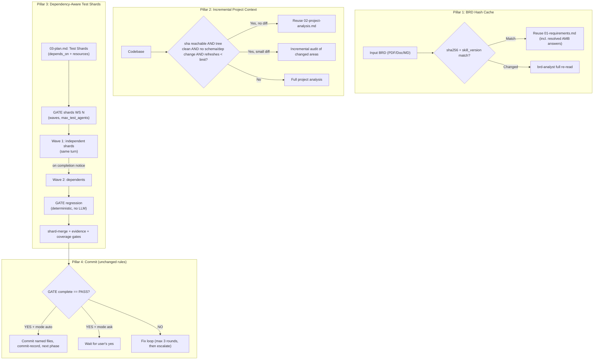

# 🚀 Implementation Plan: Faster BRD Delivery (v3)

## _BRD Hash Cache, Incremental Project Context, Deterministic Regression & Safe Commits_

> **Core Objective**: Cut per-phase turnaround in the brd-to-production workflow by skipping redundant analysis and moving work that needs no LLM (regression runs) to deterministic commands, **without weakening any existing gate** (human approval, scope, evidence, coverage, completion).

> **Already in place (no work needed)**: `--mode auto` commits after `GATE complete` passes (chosen by the user at Step 4); unit and UI testers already run in parallel in the same turn; resume already skips completed steps; Step 11 already advances to phase N+1.

---

## 🏗️ Architectural Overview



---

## 📋 Specifications

### 1. BRD Hash Cache

- **Storage**: in `state.json` (no separate cache file):
  ```json
  "brd": { "path": "...", "sha256": "...", "skill_version": "...", "analyzed_at": "..." }
  ```
- **Key**: `sha256(brd_file)` **plus** the skill / `brd-analyst` prompt version. A prompt change invalidates the cache.
- **Match**: reuse the existing `01-requirements.md`, including the AMB/CON answers the user resolved at Step 4.
- **Mismatch**: full re-read by `brd-analyst`. **No "delta only" parsing.** PDF/DOCX reflow makes deltas unreliable, REQ ids drift, and cross-references get missed.
- **Changed BRD on an approved plan**: treat as a change request. Show the user which REQs changed, then the architect re-plans the affected phases and asks for approval again.
- **GATE**: `GATE brd-hash WS <brd>` prints `MATCH` or `CHANGED`.

---

### 2. Incremental Project Context

- **Storage**: `last_analyzed_commit` and `full_refresh_count` in `state.json`. The analysis itself stays in `02-project-analysis.md`.
- **Incremental only when ALL hold**:
  - `git cat-file -e <last_analyzed_commit>` succeeds (the sha survived any rebase);
  - `git status --porcelain` is clean, or the dirty files are included in the audit;
  - no change to dependency manifests (`composer.json`, `package.json`, `requirements*.txt`, `pyproject.toml`, lockfiles);
  - no change to migrations or schema definitions (Frappe DocType JSON, Odoo `__manifest__.py`, etc.);
  - fewer than N incremental refreshes since the last full analysis (default 5).
- **Otherwise**: run a full analysis and reset the counter.
- **Known blind spot**: schema that lives only in the database (for example Frappe DocTypes customised through the UI) never shows up in git. The project analyst must check it against the DB for those stacks.
- **GATE**: `GATE context-check WS` prints `REUSE`, `INCREMENTAL <files>` or `FULL <reason>`.

---

### 3. Testing: Dependency-Aware Test Shards + Deterministic Regression

Split each phase's testing into **shards**: small, independent tester agents (`brd-test-engineer` or `brd-ui-tester`), each owning a group of ACs. They run in parallel where possible and **wait only when a real dependency or a shared resource requires it**.

#### 3.1 Shard declaration (by the architect, in `03-plan.md`)

```markdown
**Test Shards**
| id | agent | ACs | depends_on | resources |
|----|-------|-----|------------|-----------|
| S1 | brd-test-engineer | AC-001.1, AC-001.2 | - | none |
| S2 | brd-test-engineer | AC-002.1 | - | db:write |
| S3 | brd-ui-tester | AC-001.3 (login) | - | server, db:read |
| S4 | brd-ui-tester | AC-003.1 (order flow) | S3 | server, db:write |
```

- `depends_on`: logical dependency. S4 needs the login flow from S3 to pass first.
- `resources`: `none`, `db:read`, `db:write`, `server`, `fixtures:<name>`.

#### 3.2 Scheduling (`GATE shards WS N`)

- Topologically sort shards into **waves**. A cycle fails the plan check.
- Two shards that both hold `db:write` on the same DB **never run in the same wave**, unless the profile gives each its own test DB (`test_db_per_shard: true`, e.g. `test_db_<shard>`).
- `db:read` shards may share a wave with each other, but not with a `db:write` shard on the same DB.
- At most `max_test_agents` shards per wave (profile setting, default 4).
- Output: `WAVE 1: S1 S2 S3` / `WAVE 2: S4`.

#### 3.3 Waiting: orchestrator-driven, never agent polling

- The orchestrator starts every shard of a wave **in the same turn** (background).
- Shards **do not poll or sleep** waiting for each other, because that burns tokens. The orchestrator is re-invoked when a shard finishes and starts any shard whose dependencies are now done (it does not wait for the whole wave).
- If a dependency **FAILs**, its dependents are marked `BLOCKED (dep Sx failed)` and not started. They run after the fix loop.

#### 3.4 Evidence

- Each shard writes `phases/phase-N/shards/<id>/report.md`, `bugs.md` and `evidence/`.
- `GATE shard-merge WS N` merges the shard reports into the existing `test-report.md` and `ui-report.md`, so the evidence and coverage gates keep working unchanged. `GATE bugs` reads the shard `bugs.md` files directly.
- Each AC must belong to **exactly one** shard (plan check), so coverage has no gaps or double counts.

#### 3.5 When not to shard

- A phase with ≤ 3 ACs or a single UI flow runs with one test engineer + one UI tester, as today. A cold start (re-reading phase, profile, ACs) costs more than it saves on small phases.
- Independence rule unchanged: every shard designs its cases from the ACs **before** reading the implementation.

#### 3.6 Regression: deterministic, not an agent

- `GATE regression WS N` re-runs every earlier phase's suites and flows and writes JUnit XML to `evidence/regression-K`. No LLM needed.
- It runs as the **last wave** (or earlier on its own test DB), never alongside `db:write` shards on the same DB.
- `GATE complete` requires the latest regression evidence to be green.
- Fix loop: only failed shards and their dependents are re-run, then `GATE regression` runs again.

---

### 4. Commits (rules unchanged)

- The commit mode **stays the user's explicit choice at Step 4** (`GATE approve --mode auto|ask --quote ...`). **No default to auto.**
- Stage files **by name**: the phase files, its tests, and the specific `docs/brd-to-production/` reports. **Never `git add <dir>` or `-A`.** `evidence/` can contain screenshots, network logs or tokens.
- Run the secret-guard scan on the staged files before committing.
- Keep the rules: no `--no-verify`, no amend, no force-push, no push unless asked.
- Fix loop limit stays **3 rounds**, matching `brd_gate.py fix-round`.

---

## ⏱️ Expected Gains (targets, not measurements)

> Measure a baseline on one real project before quoting numbers. Record wall-clock time per step in `decisions.md` with `GATE log`.

| Step                    | Where the time goes today                        | Change                                   | Expected effect                       |
| :---------------------- | :----------------------------------------------- | :--------------------------------------- | :------------------------------------ |
| 1 BRD analysis          | Full read on every **new** run (resume already skips it) | Hash match → reuse               | Large on re-runs, none on first run   |
| 2 Project analysis      | Full analysis on every new run                   | Incremental when safe                    | Large on repeat runs in one repo      |
| 6–7 Testing             | 2 testers cover all ACs; full regression re-run by agents every round | Shards in dependency waves + regression script + failed-shard-only re-runs | Largest on big phases; more tokens per phase |
| 9 Commit                | Already instant in `auto` mode                   | None                                     | —                                     |

---

## ✅ Implementation Checklist

- [x] `GATE brd-hash`: sha256 + analyst prompt version in `state.json`, reuse across workspaces; SKILL.md Step 1 uses it.
- [x] Changed-BRD flow: `brd-hash` flags a change on an approved plan as a change request; SKILL.md says re-plan → re-approval (the REQ diff itself is done by the orchestrator).
- [x] `GATE context-check`: sha reachability, dirty-file snapshot, dependency/schema change detection, full-refresh counter; incremental mode in the project analyst prompt.
- [x] Architect prompt + artifacts.md: `Test Shards` table format; plan check (every AC in exactly one shard, no cycles).
- [x] `GATE shards WS N`: wave scheduling with `depends_on`, resource conflicts, `max_test_agents`; `--done/--running/--failed` prints READY / WAITING / BLOCKED.
- [x] Profile keys: `max_test_agents`, `test_db_per_shard`, `context_full_refresh_every` (all 10 templates).
- [x] SKILL.md Step 5: wave dispatch, start dependents on completion, mark BLOCKED on failed dependency.
- [x] `GATE shard-merge WS N`: merge shard reports into the existing report files; `GATE bugs` reads shard bug files.
- [x] `GATE regression WS N`: smoke + this run + earlier runs' suites, optional `commands.regression`, UI/API flows; JUnit evidence + `summary.json`.
- [x] `GATE complete`: re-merges shards; for phase ≥ 1 requires a passing regression run with an unchanged code fingerprint.
- [x] Update `brd-test-engineer` and `brd-ui-tester` prompts: shard scope (own ACs only), shard paths, no polling; regression left to `GATE regression`.
- [x] Tests for the new gate commands: `tests/test_brd_gate.py` (24 tests).
- [ ] Baseline timing on one real project before and after.
